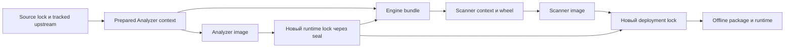

# Locks, образы и доверенные артефакты

| Артефакт | Источник и назначение |
| --- | --- |
| `upstream.lock.json` | Reviewed source lock: upstream commit/export-list/hashes, модель/файлы, patch before/after, build profiles |
| Prepared manifest | Результат `analyzer.py prepare`: точный allowlisted context и его hashes |
| Offline artifact lock | Полный platform closure с URL/размером/SHA-256; model/wheels/Debian и назначение для компонентов |
| Analyzer runtime lock | Результат `seal` конкретного image: platform/reference IDs, packages, model/spaCy/sources/settings/signature |
| Engine directory | Четыре проверенных файла: `source-lock.json`, `runtime-lock.json`, `dictionary_policy.py`, `dictionary.json` |
| Scanner inventory | Hashes точного Dockerfile, wheels, `.deb`, engine; base/platform/Git/requirements/wheel identity |
| Deployment lock | Scanner и Analyzer immutable IDs + engine/runtime hash и inventory; выбирает готовый runtime |
| Offline checksums | Hashes `images.tar`, deployment и четырёх engine assets; проверяются до load |

Поток **новой** сборки:

Один выбранный runtime lock проходит parity, engine exporter и CLI-проверки;
созданный из него deployment проходит verify/production acceptance/export.
Готовый пакет продолжает использовать **свой** deployment. Пошаговые команды —
в [fresh build](../admin/build.md), без смешивания со штатными locks прежней сборки.

## Reference ID и platform ID

На Docker 29/containerd обычный inspect может вернуть OCI index ID, который
нужен как локальная ссылка запуска. Platform inspect возвращает идентичность
конкретной `linux/arm64` manifest/config. Runtime сохраняет `image_reference_id`,
`image_id`, kind/descriptor; deployment — reference/platform IDs обоих images.
Оба формата `sha256:...`, но разные значения нельзя менять местами.

`image_id` входит в fingerprint распознавания; mutable tag не доказывает
идентичность. Отсутствие/несовпадение локального image даёт отказ, не pull/fallback.
Повторная сборка требует своего seal и приёмки, даже при тех же source files.

## Что проверка не доказывает

Hash, валидная структура JSON и совместимый профиль не удостоверяют происхождение
произвольного файла/образа. Source/locks/образ/модель/host/daemon и процесс
допуска baseline доверенные. Цифровой подписи offline-пакета нет; checksum manifest
также защищается при передаче. Не импортируйте неизвестные tar/locks.

Не меняйте manifest, expected image ID или model hash ради успешной проверки.
Смена артефактов/детекторов требует отдельного reviewed обновления и нового
snapshot; [правила](../admin/updating-analyzer.md). Штатные locks в Git — записи
исторических локальных сборок, а не обещание доступности image в registry.

## Подготовка и корпоративные настройки

Историческая upstream recipe разрешает явные `--build-arg`:
`HTTP_PROXY`, `HTTPS_PROXY`, `NO_PROXY`, `PIP_INDEX_URL`, `PIP_TRUSTED_HOST`,
`PIP_PROXY`, `PYTORCH_INDEX_URL`, `PYTORCH_GPU_INDEX_URL`, `NER_MODEL_PROXY`.
Не передавайте credentials: upstream build/log может их раскрыть. Явный
`prepare --certs-dir` включает хеши `*.crt` в manifest; прочие соседние файлы
не экспортируются. Текущая offline CPU recipe не скачивает эти inputs в build:
`prepare_offline_analyzer.py --download` и scanner prepare `--download-artifacts`
явно заполняют cache, `--ca` применяется только host downloader. Без этих флагов
подготовка не обращается к сети. Старые pip/apt config flags отклоняются.
[Различие и команды](../admin/build.md#корпоративные-mirrors-proxy-и-ca).

Модель/каталог и подпись — в [механизме распознавания](detection.md),
JSON/output metadata policy — в [runtime](runtime.md),
лицензии/notices — [отдельно](../licensing.md).
