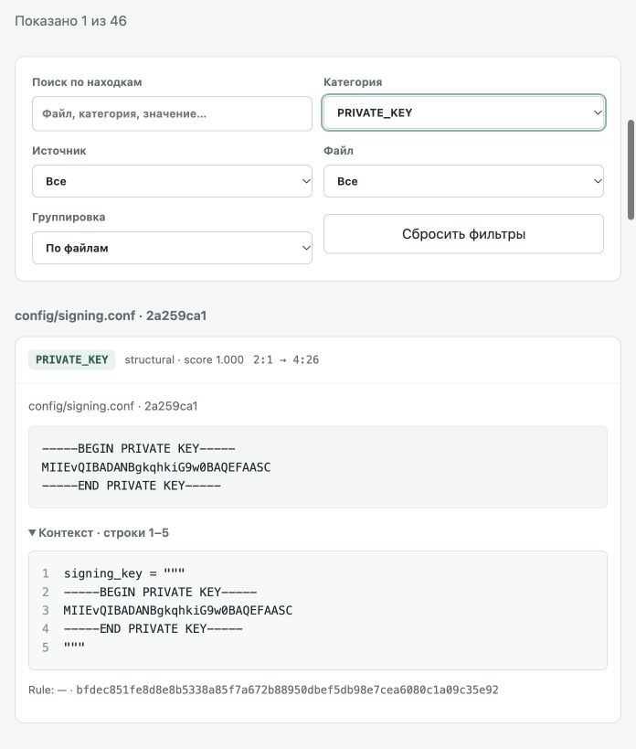

# Проверка этапа 5

План [#9](https://github.com/vovkins/ru-llm-scanner/issues/9) согласован 2026-10-19.
Реализованы CLI snapshot/diff, JSON/HTML v1, runtime schema/semantic validation,
доверенный baseline A→B→C и безопасная публикация артефактов. Штатные
Docker/Compose/Jenkins относятся к следующему этапу, релиз не публиковался.

## Проверки и воспроизводимость

| Набор | Результат | Среда |
| --- | --- | --- |
| [Полный unittest](unit-tests.json) | 123 passed, без skipped; 27 новых test method | macOS ARM64, Python 3.12.14/Git 2.39.5 |
| [Установленный CLI](cli-verification.json) | 9/9 реальных offline-сценариев | Linux ARM64, UID 65534/read-only FS/no capabilities |
| [Pipeline/direct-model parity](scan-verification.json) | 46/46 файлов | Закреплённый Analyzer и словарь, без внешней сети |
| [Визуальная QA](html-qa.json) | clean/findings/incomplete и отдельный UI stress | Встроенный браузер, viewport 696×818, loopback HTTP |

[Команды установки/экспорта engine/wheel/offline-прогона](../../docs/cli-quickstart.md),
[полный unit runner](../../docs/development.md). Assert-логи и полные синтетические
QA-отчёты остаются в `.build/`; опубликованные JSON не содержат values/context.
Хеши кода, схемы, корпуса и actual platform/reference Image ID сохранены.

Unit-проверки охватывают аргументы/help/version/пустые значения, приоритет CLI
над strict JSON, путь с `=` в encoding, отсутствие значений в консоли,
ранние/частичные ошибки, final report/код 0/1/2, SIGINT с сохранением находок.
Runtime validator проверяет counters, IDs/raw paths, ссылки rename/deleted и
evidence, profile/manifest, координаты относительно полного context и статусы.
Ошибки validation не печатают instance/values. Schema пакуется в wheel и
побайтно сверяется с публичной schema; production не импортирует dev checker.

Baseline-тесты включают A→B→C, immediate evidence ID, SHA-256 Git, merge,
смену mode/type, rename/delete, неподдерживаемые/исключённые записи,
несовместимые score/scope, совместимые presentation/execution и отказ при
findings, битом JSON/duplicate/NaN, неверном commit/tree/manifest/ссылке,
contract_example, отсутствии required baseline и неоконченном preflight.
Fallback не применяется. Все входные репозитории остаются неизменными.

Output-проверки: новая/пустая папка, права 0600, existing output, symlink в
пути/финальном имени, конкурентный writer, read-only каталог, сохранность
прежнего файла, очистка tmp, сбой HTML/renderer с исправлением JSON на код 2.
Двухфайловой транзакции нет; полный отказ FS может помешать исправлению
ранее записанного статуса. Доверенный процесс принимает baseline только
после успешного кода процесса, а не по наличию JSON.

## Реальная модель и качество

В dev-образ установлен проверенный wheel; каждый модуль и packaged schema
сверены с текущими исходниками. Вызывается console entry point. Сценарии:
clean snapshot, diff A/B и B/C с baseline, A=B без baseline, incompatible
profile, отклонённый contract_example, весь code-v1, partial decode error и
missing revision. Формируются оба артефакта, полные значения сверяются с
исходным текстом, сводка — с точным разрешённым набором полей.

Проверка консоли структурная: короткие spans модели могут случайно совпасть
с частью SHA или служебного слова, поэтому простой поиск подстроки не является
надёжным доказательством утечки. В unit дополнительно проверяются длинные
синтетические маркеры/ошибки и отсутствие traceback.

Независимый code-v1 неизменен: 37 ожидаемых мест, exact TP=33 / FP=13 / FN=4,
precision 71.74%, recall 89.19%, 46 итоговых находок. Полностью пропущен телефон;
bearer/base64/INN имеют ошибки категорий/границ, есть extras. Подробный разбор —
в [этапе 4](../stage-4/README.md). Модель/правила/threshold/allowlist не менялись;
CLI/отчёт/baseline не повышают полноту детекторов. Обновление механизма —
отдельная согласуемая работа.

## HTML QA и ограничения

В браузере проверены все три итоговых состояния, фильтры category/source/file,
поиск с нулевым результатом, reset, группировка, многострочный ключ с номерами
строк и полным value. Отдельный controlled-transport stress-отчёт проверяет
длинный путь/значение, CRLF/emoji/combining, HTML/JS/SVG-подобный текст,
управляющие символы и два разных raw path с одинаковым display path.
Текст показан буквально, layout читабелен; UI stress не включён в метрики NER.
Автотест проверяет единственный статический script, CSP hashes, отсутствие
event handlers/активных img/svg/iframe и использования innerHTML.

Прямое `file://` открытие заблокировано URL-политикой встроенного браузера;
этот путь не объявляется проверенным. Визуальная QA проведена через локальный
HTTP. В HTML все JS/CSS встроены, CSP запрещает connect и внешние ресурсы;
модельные контейнеры отдельно проверены без внешнего маршрута. Другие браузеры,
viewport и Windows-native не заявлены проверенными.

CPU ARM64 проверен; GPU без CUDA не проверен. Собственные временные контейнеры
и QA-сервер остановлены. Исходный proxy/locks/модель/словарь не менялись,
действующие проекты не останавливались. Лицензия/настройки GitHub/Jenkins и
релизы не изменялись; production-упаковка ожидает отдельного этапа.
